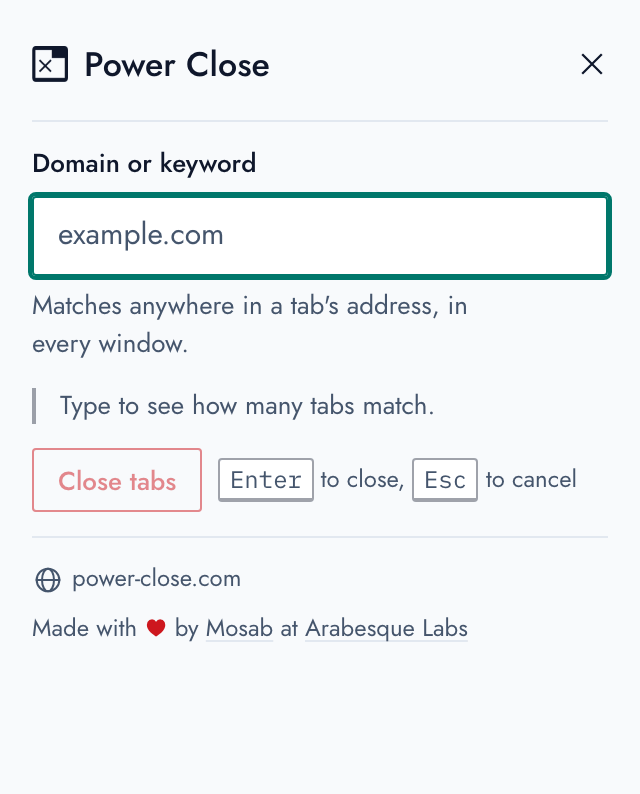

# Power Close

A browser extension, for the tab addict, to close all tabs with URLs containing
a keyword or a domain name. For example, if you have many facebook tabs open and
not in order, you can just use this extension, write "facebook.com", hit enter
and voila, all facebook tabs -containing the string 'facebook.com'- are now
closed!

# Building Locally

Just run `make` in the root directory:

```
$ make
```

Built plugins will live in the `dist` directory:

```
➜  power-close git:(master) tree dist
dist
├── chrome
│   ├── background.js
│   ├── icons
│   │   ├── 128.png
│   │   ├── 16.png
│   │   ├── 19.png
│   │   ├── 38.png
│   │   └── 48.png
│   ├── manifest.json
│   ├── popup
│   │   ├── popup.css
│   │   ├── popup.html
│   │   └── popup.js
│   ├── power-close.zip
│   └── vendor
│       └── arabesque
│           ├── arabesque.css
│           └── fonts
└── firefox
    ├── background.js
    ├── icons
    │   ├── 128.png
    │   ├── 16.png
    │   ├── 19.png
    │   ├── 38.png
    │   └── 48.png
    ├── manifest.json
    ├── popup
    │   ├── popup.css
    │   ├── popup.html
    │   └── popup.js
    ├── power-close.zip
    └── vendor
        └── arabesque
            ├── arabesque.css
            └── fonts
```

# Usage

After installation, the Power Close icon appears as a button in your browser's
toolbar. Press on it, and an input field will appear. Write the keyword or domain name in
it: the popup counts the tabs it matches as you type, across every window, so
you can see what will close before anything does. Press enter, or the button
that names the count, and voila! It then tells you how many it closed.

You can also right-click a page and choose "Close all tabs from this domain".

<picture>
  <source media="(prefers-color-scheme: dark)" srcset="website/screenshots/demo-dark.gif">
  
</picture>

The screenshots, on the website and here, are taken by `make screenshots`
(Node 22+, Chrome and ffmpeg): the popup from `src/`, over a dozen made-up
tabs, in light and dark, and a GIF of it in use.

# Website

[power-close.com](https://www.power-close.com) is the static site in
`website/`, with no build step: deploy the folder as it is. It's built on the
same design system, vendored into `website/vendor/arabesque/` (see the
README there).

# Design

The popup is built on the [Arabesque Labs design
system](https://design.arabesquelabs.com/)
([source](https://github.com/ArabesqueLabs/design-system)): its tokens, its
components (`al-field`, `al-button`, `al-notice`...) and its rule that every
consequence of an action is shown before the action is taken. It follows the
browser's light or dark setting, and the keyboard path the extension was always
built around is unchanged.

An extension page can't load CSS or fonts from a remote origin under its content
security policy, so the built design system is copied into
`src/vendor/arabesque/`. See
[`src/vendor/arabesque/README.md`](src/vendor/arabesque/README.md) for what came
from where, and how to upgrade it.

# Icon

The icon used for the logo and the toolbar button is a mash of two icons from
Google's [Material Design Icons](https://design.google.com/icons/) that are
published as an open source project under the [CC-By
License](https://creativecommons.org/licenses/by/4.0/).

In older versions of the addon, the logo used to be one of the icons designed by
[Freepik](http://www.freepik.com) from [Flat Icon](http://www.flaticon.com),
that was also licensed under [CC-BY
License](http://creativecommons.org/licenses/by/3.0/), although a different
version of it.

# License

```
Power Close, close browser tabs based on keywords or domain names
Copyright (C) 2014  Mosab Ibrahim

This program is free software; you can redistribute it and/or
modify it under the terms of the GNU General Public License
as published by the Free Software Foundation; either version 2
of the License, or (at your option) any later version.

This program is distributed in the hope that it will be useful,
but WITHOUT ANY WARRANTY; without even the implied warranty of
MERCHANTABILITY or FITNESS FOR A PARTICULAR PURPOSE.  See the
GNU General Public License for more details.

You should have received a copy of the GNU General Public License
along with this program; if not, write to the Free Software
Foundation, Inc., 51 Franklin Street, Fifth Floor, Boston, MA  02110-1301, USA.
```
